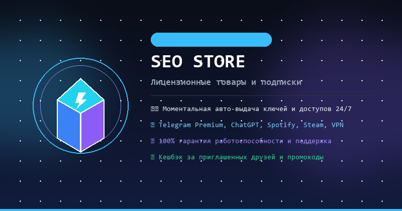

# 🛒 Telegram Store Bot

<p align="center">
  
</p>

<p align="center">
  <a href="https://github.com/txltedxgod/telegram-store-bot/actions/workflows/ci.yml"></a>
  <a href="https://t.me/seostrbot"></a>
  
  
  
</p>

---

## 🎮 Живое демо в Telegram

Бот запущен 24/7 и открыт для тестирования: **[@seostrbot](https://t.me/seostrbot)**

В живой демо-версии настроены:
- ⚡️ **5 категорий цифровых товаров**: Подписки & Premium, AI & Нейросети, Софт & Лицензии, VPN & Безопасность, Игры & Steam.
- 📦 **16 реалистичных позиций**: Telegram Premium, ChatGPT Plus, Midjourney, Claude Pro, Spotify, YouTube Premium, Steam Gift Cards, Shadowsocks VPN.
- 🎟 **Промокоды**: `WELCOME10` (скидка 10%), `VIP20` (скидка 20%), `SPRING15` (скидка 15%).
- 🎁 **Реферальная система**: начисление бонусов за приглашения друзей через `/ref`.
- 🧺 **Корзина, избранное, поиск и оформление заказа** через конечные автоматы (FSM).

---

## ✨ Возможности

### Пользовательская часть
* 🛒 **Каталог** с категориями, карточками товаров и моментальной пагинацией
* 🧺 **Корзина**: добавление, изменение количества, удаление, очистка
* ✅ **Оформление заказа** через FSM (контакт → комментарий → подтверждение)
* 📦 **Мои заказы** и история покупок с реальными статусами
* 👤 **Личный кабинет**: баланс, количество заказов, общая сумма покупок
* ⭐ **Избранное**: быстрый доступ к отложенным товарам
* 🔍 **Поиск товаров** по названию и описанию
* 🎁 **Реферальная программа** (`/ref`, deep-link `start=ref_<id>`)
* 🏷 **Промокоды** со скидками в процентах

### Админ-панель (`/admin`)
* ➕ Добавление товара через интерактивный диалог FSM
* ✏️ Редактирование товара (название, цена, описание, остаток на складе)
* ❌ Удаление и отключение товара
* 📦 Управление заказами и смена статусов с моментальным уведомлением покупателя
* 📊 Аналитика и статистика (пользователи, заказы, оборот за сегодня и за всё время)
* 🏆 Топ популярных товаров
* 📢 Массовая рассылка сообщений с отчётом о доставке
* 🏷 Создание промокодов
* 📄 Экспорт базы заказов в CSV

---

## 🧱 Стек технологий

| Технология | Назначение |
|---|---|
| **Python 3.12+** | Язык разработки |
| **aiogram 3.31+** | Telegram Bot API, роутеры, FSM, middlewares, цветные инлайн-кнопки |
| **SQLAlchemy 2.0 (async)** | Modern Async ORM, асинхронный доступ к БД |
| **PostgreSQL / SQLite** | Реляционная СУБД с полной совместимостью (`asyncpg` / `aiosqlite`) |
| **Alembic** | Миграции схемы базы данных |
| **pydantic-settings** | Строго типизированная конфигурация из окружения `.env` |
| **pytest & pytest-asyncio** | Автоматизированный тестовый набор |
| **Docker & Docker Compose** | Контейнеризация и оркестрация |

---

## 🚀 Быстрый старт

### 1. Клонирование репозитория
```bash
git clone https://github.com/txltedxgod/telegram-store-bot.git
cd telegram-store-bot
```

### 2. Настройка окружения
```bash
cp .env.example .env
```
Заполните в `.env`:
* `BOT_TOKEN` — токен от [@BotFather](https://t.me/BotFather)
* `ADMIN_IDS` — ваш Telegram ID (узнать можно у [@userinfobot](https://t.me/userinfobot))
* `DATABASE_URL` — строка подключения к PostgreSQL или SQLite (`sqlite+aiosqlite:///store.db`)

---

## 🐳 Запуск через Docker Compose

Поднятие PostgreSQL и контейнера бота одной командой:
```bash
docker compose up -d
```

Просмотр логов:
```bash
docker compose logs -f bot
```

Остановка:
```bash
docker compose down
```

---

## 💻 Локальный запуск и разработка

```bash
python -m venv .venv
# Linux / macOS:
source .venv/bin/activate
# Windows:
.\.venv\Scripts\Activate.ps1

pip install -r requirements.txt
python -m bot.bot
```

---

## 🧪 Тестирование

Проект покрыт автоматическими тестами бизнес-логики, сервисов, генерации инлайн-клавиатур и рендеринга текстов:

```bash
pytest -v
```

---

## 🗂 Структура проекта

```
telegram-store-bot/
├── assets/              # Аватар бота и приветственный баннер
├── bot/
│   ├── handlers/        # Роутеры: start, catalog, cart, checkout, orders, profile, admin
│   ├── keyboards/       # Inline-клавиатуры и CallbackData фабрики
│   ├── middlewares/     # Database session, logging, user tracking
│   ├── services/        # Чистая бизнес-логика и сервисы (users, cart, orders, promo)
│   ├── database/        # ORM Base, Engine, Models, Seeder
│   ├── states/          # FSM состояния (Checkout, Admin, Search)
│   ├── utils/           # Форматирование валют, тексты, UI переходы
│   ├── config.py        # Pydantic Settings
│   └── bot.py           # Точка входа polling/webhook
├── tests/               # Pytest suite (services, keyboards, texts)
├── docker-compose.yml
├── Dockerfile
├── requirements.txt
└── README.md
```

---

## 📄 Лицензия

Распространяется под лицензией [MIT](LICENSE).
