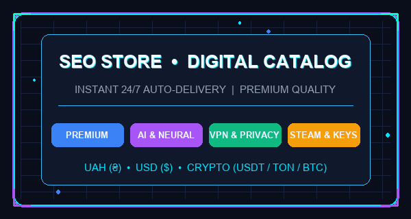

# 🛒 Telegram Store Bot

<p align="center">
  
</p>

<p align="center">
  <a href="https://github.com/txltedxgod/telegram-store-bot/actions/workflows/ci.yml"></a>
  <a href="https://t.me/seostrbot"></a>
  
  
  
  
</p>

---

## 🎮 Живе демо в Telegram / Live Telegram Demo

Бот розгорнутий 24/7 та відкритий для тестування: **[@seostrbot](https://t.me/seostrbot)**

В живому магазині реалізовано:
- 🌐 **Мультимовність з вибором на старті**: Українська (🇺🇦) та English (🇬🇧).
- 🎬 **Анімований HUD-банер каталогу (`assets/catalog.gif`)** над списком категорій.
- 💰 **Подвійне відображення цін**: гривні (₴) та долари ($).
- 💳 **Гнучкі способи оплати**: банківська картка (UAH Monobank / ПриватБанк) та криптовалюта (USDT TRC-20, TON, Bitcoin).
- ⚡️ **5 категорій цифрових товарів**: Підписки & Premium, AI & Нейромережі, Софт & Ліцензії, Безпека & VPN, Ігри & Steam.
- 📦 **16 реалістичних позицій**: Telegram Premium, ChatGPT Plus, Midjourney, Claude Pro, Spotify, YouTube Premium, Steam Gift Cards, Shadowsocks VPN.
- 🎟 **Промокоди**: `WELCOME10` (знижка 10%), `VIP20` (знижка 20%), `SPRING15` (знижка 15%).
- 🎁 **Реферальна програма**: нарахування бонусів за запрошення друзів через `/ref`.

<p align="center">
  
</p>

---

## ✨ Можливості / Features

### Клієнтська частина / User Features
* 🌐 **Вибір мови** при першому вході (🇺🇦 Українська / 🇬🇧 English) та швидка зміна в один клік
* 🛒 **Інтерактивний каталог** з анімованим GIF-банером, категоріями та пагінацією
* 🧺 **Кошик**: додавання, зміна кількості (➕/➖), швидке видалення та повне очищення
* 💳 **Оформлення замовлення (FSM)**: вибір способу оплати (Картка UAH / Криптовалюта) → контакт → коментар → реквізити
* 📦 **Мої замовлення**: детальна історія покупок з динамічними статусами
* 👤 **Особистий кабінет**: баланс, кількість замовлень, загальна сума покупок
* ⭐ **Обране**: збереження вподобаних товарів для швидкого доступу
* 🔍 **Пошук товарів** за назвою та ключовими словами
* 🎁 **Реферальна система** (`/ref`, deep-link `start=ref_<id>`)
* 🏷 **Промокоди** з відсотковими знижками

### Адмін-панель (`/admin`)
* ➕ Додавання нових товарів через покроковий FSM-діалог
* ✏️ Редагування товарів (назва, ціна, опис, залишок на складі)
* ❌ Видалення та деактивація товарів
* 📦 Управління замовленнями та зміна статусів з миттєвим сповіщенням покупця
* 📊 Аналітика та статистика (користувачі, замовлення, оборот)
* 🏆 Топ популярних товарів
* 📢 Масова розсилка повідомлень клієнтам
* 🏷 Створення та налаштування промокодів
* 📄 Експорт бази замовлень у CSV

---

## 🧱 Стек технологій

| Технологія | Призначення |
|---|---|
| **Python 3.12+** | Основна мова розробки |
| **aiogram 3.31+** | Telegram Bot API, роутери, FSM, middlewares, інлайн-клавіатури |
| **SQLAlchemy 2.0 (async)** | Modern Async ORM, асинхронний доступ до БД |
| **PostgreSQL / SQLite** | Реляційна СУБД з повною сумісністю (`asyncpg` / `aiosqlite`) |
| **Alembic** | Міграції схеми бази даних |
| **pydantic-settings** | Сувора типізація конфігурації з `.env` |
| **pytest & pytest-asyncio** | Покриття юніт- та інтеграційними тестами (15 тестів) |
| **Docker & Docker Compose** | Контейнеризація та оркестрація |

---

## 🚀 Швидкий старт

### 1. Клонування репозиторію
```bash
git clone https://github.com/txltedxgod/telegram-store-bot.git
cd telegram-store-bot
```

### 2. Налаштування оточення
```bash
cp .env.example .env
```
Заповніть у `.env`:
* `BOT_TOKEN` — токен від [@BotFather](https://t.me/BotFather)
* `ADMIN_IDS` — ваш Telegram ID (дізнатися можна в [@userinfobot](https://t.me/userinfobot))
* `DATABASE_URL` — рядок підключення до PostgreSQL або SQLite (`sqlite+aiosqlite:///store.db`)

---

## 🐳 Запуск через Docker Compose

Підняття PostgreSQL та контейнера бота однією командою:
```bash
docker compose up -d
```

Перегляд логів:
```bash
docker compose logs -f bot
```

Зупинка:
```bash
docker compose down
```

---

## 💻 Локальний запуск

```bash
python -m venv .venv
source .venv/bin/activate  # на Windows: .\.venv\Scripts\Activate.ps1
pip install -r requirements.txt
python -m bot.bot
```

---

## 🧪 Тестування

Проект покритий автоматичними тестами:
```bash
pytest -v
```

---

## 🗂 Структура проекту

```
telegram-store-bot/
├── assets/              # Аватар бота, welcome banner та catalog.gif
├── bot/
│   ├── handlers/        # Роутери: start, catalog, cart, checkout, orders, profile, admin
│   ├── keyboards/       # Inline-клавіатури та CallbackData фабрики
│   ├── middlewares/     # Database session, logging, user tracking
│   ├── services/        # Чиста бізнес-логіка (users, cart, orders, promo)
│   ├── database/        # ORM Base, Engine, Models, Seeder
│   ├── states/          # FSM стани (Checkout, Admin, Search)
│   ├── utils/           # Emojis, форматування цін (₴ / $), тексти, UI переходи
│   ├── config.py        # Pydantic Settings
│   └── bot.py           # Точка входу polling
├── tests/               # Pytest suite (services, keyboards, texts)
├── docker-compose.yml
├── Dockerfile
├── requirements.txt
└── README.md
```

---

## 📄 Ліцензія

Розповсюджується під ліцензією [MIT](LICENSE).
